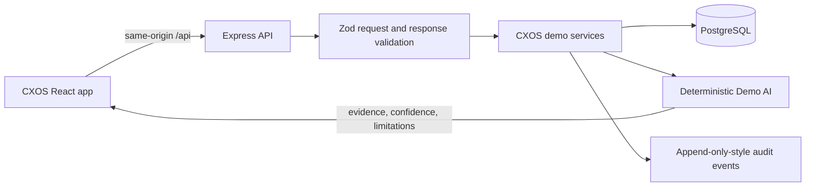

# CXOS — Customer Experience Operating System

CXOS turns early customer signals into explainable, human-reviewed service actions. The demo follows one customer story from repeated contact and dissatisfaction through a proposed rescue, reviewer approval, simulated action, and audit trail.

**Tagline:** Turn every customer interaction into a better experience.

## Demo status

- All seeded customer, order, conversation, and feedback records are synthetic.
- The assistant is **Demo AI**: deterministic, server-side responses grounded in the demo dataset. No model provider or customer data is contacted.
- Churn scores and business impact are estimates, not guarantees. Rescue outcomes are simulated.
- Recommendations do not execute by themselves. A reviewer approves first; the separate execution endpoint only changes synthetic demo state.
- The current demo has one shared synthetic workspace and no login or multi-tenant access control. Do not use it with real customer data or treat it as a production CX platform.

## Product flow

**Listen → Understand → Predict → Recommend → Act → Learn**

The fastest demo is Sarah Williams: inspect repeated delivery contacts and declining sentiment, approve the evidence-backed action, run the simulated rescue, then check the updated profile and audit log.

## Architecture

- `artifacts/cxos` — React, TypeScript, Vite application and routes.
- `artifacts/api-server` — shared Express API, validation, security headers, rate limiting, CXOS services.
- `lib/api-spec/openapi.yaml` — source API contract; generated hooks and schemas live in `lib/api-client-react` and `lib/api-zod`.
- `lib/db/src/schema/cxos.ts` — PostgreSQL demo-state and audit schema.
- `docs/` — threat model, controls, architecture, pitch and demo guide.

## Run

This workspace uses pnpm and the configured API and web workflows. For a fresh environment:

1. Provide a PostgreSQL `DATABASE_URL` through the workspace secrets flow.
2. Install dependencies with `pnpm install`.
3. Apply the development schema: `pnpm --filter @workspace/db run push`.
4. Start the API and web workflows; the web app calls the API through `/api`.

The app will seed synthetic data on first use. Use **Reset demo** to restore the starting state. Do not put credentials in source files or commit local environment files.

## API overview

| Endpoint | Purpose |
| --- | --- |
| `GET /api/healthz` | Service health |
| `GET /api/cxos/overview` | Executive metrics and trends |
| `GET /api/cxos/customers` | Search and risk-filter customers |
| `GET /api/cxos/customers/:customerId` | Customer 360 and timeline |
| `POST /api/cxos/customers/:customerId/resolve` | Resolve one synthetic open issue |
| `POST /api/cxos/customers/:customerId/escalate` | Record a human-initiated senior-agent escalation |
| `GET /api/cxos/intelligence` | Emotion, root causes, journey and feedback |
| `GET /api/cxos/actions` | Human review queue |
| `POST /api/cxos/actions/:actionId/decision` | Approve, modify or reject |
| `POST /api/cxos/rescues/:customerId/execute` | Execute approved demo rescue |
| `POST /api/cxos/copilot` | Grounded deterministic demo answer |
| `GET /api/cxos/audit` | Recent audit events |
| `POST /api/cxos/demo/reset` | Restore the demo dataset |

All request bodies and returned API shapes are validated with generated Zod schemas. Database access uses Drizzle; values are not interpolated into SQL.

## Development checks

- `pnpm run typecheck`
- `pnpm --filter @workspace/api-server run typecheck`
- `pnpm --filter @workspace/cxos run typecheck`
- `pnpm --filter @workspace/api-spec run codegen`

See `docs/SECURITY.md` for implemented controls and limitations. This demo is not a compliance or security certification.